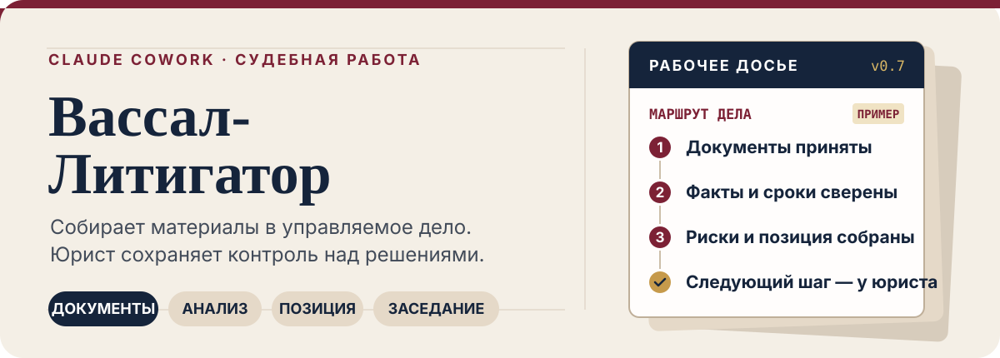

<p align="center">
  
</p>

<p align="center">
  <strong>Из россыпи документов — в понятное, проверяемое и управляемое дело.</strong><br>
  Плагин для Claude Cowork, который помогает юристу пройти путь от первичного приёма материалов до кассационной жалобы.
</p>

> [!IMPORTANT]
> **Материалы дела передаются в Anthropic через Claude.** Это касается текстов документов, их рабочих копий и метаданных. Если такая передача противоречит требованиям вашей юрисдикции или договору с доверителем, не устанавливайте плагин.

## Что меняется в работе

Вы складываете PDF, документы, сканы, фотографии и архивы в одну папку. Вассал-Литигатор:

- распознаёт и систематизирует материалы;
- собирает карточку дела, реестр документов и юридическую хронологию;
- помогает проверить квалификацию, сроки, подсудность и доказательства;
- формирует позицию с доводами, рисками и вариантами стратегии;
- готовит материалы к заседанию и разбирает его транскрипцию;
- собирает проекты процессуальных документов, апелляционной и кассационной жалоб.

На каждом юридически значимом шаге решение остаётся за юристом.

<p align="center">
  
</p>

## Первое дело

### 1. Установите плагин

Понадобятся:

- [Claude Cowork](https://claude.ai/code);
- пользовательский скилл `arbitrum-docx` для оформления документов `.docx`.

Скачайте архив последней версии на странице [Releases](../../releases), затем добавьте **весь архив** через интерфейс управления плагинами в Claude Cowork.

> Не скачивайте отдельные файлы репозитория: Cowork устанавливает плагин как цельный пакет.

### 2. Подготовьте материалы

Создайте папку будущего дела и положите в неё всё, что передал клиент: PDF, DOCX, сканы, фотографии или ZIP-архивы. Ничего заранее сортировать и переименовывать не нужно.

### 3. Запустите приём дела

Откройте папку в Claude Cowork и выполните:

```text
/vassal-litigator:init-case
```

Плагин обработает документы, предложит план раскладки, создаст реестр и спросит только те данные о деле, которые не удалось уверенно извлечь из материалов.

## Что останется в папке дела

- **Карточка дела** — стороны, суд, предмет, суммы, даты и статус.
- **Реестр документов** — единая таблица материалов с краткими описаниями.
- **Текстовые копии** — полнотекстовые версии документов для поиска и анализа; оригиналы при этом сохраняются.
- **Хронология** — события и процессуальные даты со ссылками на источники.
- **Правовой анализ** — квалификация, сроки, подсудность и пробелы в доказательствах.
- **Правовая позиция** — фабула, доводы, риски и стратегия в Markdown и DOCX.
- **Материалы заседания** — заметки, сценарий, ходатайства и последующий разбор.
- **Процессуальные документы** — проект решения, апелляционная и кассационная жалобы.

## Юрист остаётся главным

Вассал-Литигатор устроен как исполнитель, а не как автономный советник:

1. **Сначала показывает план.** Раскладка файлов и другие значимые изменения применяются только после подтверждения.
2. **Сохраняет оригиналы.** Исходные материалы остаются в отдельном хранилище внутри дела.
3. **Объясняет выводы.** Аналитика связывает вывод с фактами, нормами и степенью уверенности.
4. **Помнит историю работы.** Действия и созданные материалы фиксируются в журнале дела.
5. **Не плодит дубликаты.** Повторный запуск синхронизирует данные, а не создаёт вторые копии.

Плагин ускоряет подготовительную и аналитическую работу, но не заменяет профессиональное суждение юриста и проверку итогового документа перед использованием.

## Команды по ситуации

- **Начинаю новое дело** → `/vassal-litigator:init-case` создаст структуру, примет материалы и заполнит карточку.
- **Хочу увидеть все документы** → `/vassal-litigator:catalog` соберёт реестр в XLSX.
- **Нужно разобраться в фабуле и рисках** → `/vassal-litigator:legal-review` проведёт комплексный правовой анализ.
- **Нужна линия защиты или нападения** → `/vassal-litigator:build-position` подготовит позицию с оценкой рисков.
- **Готовлюсь к заседанию** → `/vassal-litigator:prepare-hearing` соберёт заметки, сценарий и проекты ходатайств.
- **Заседание уже прошло** → `/vassal-litigator:analyze-hearing` разберёт транскрипцию и предложит тактические выводы.
- **Нужно обжаловать судебный акт** → `/vassal-litigator:appeal` или `/vassal-litigator:cassation` подготовит проект жалобы.

<details>
<summary><strong>Полный список команд</strong></summary>

| Команда | Назначение |
| --- | --- |
| `init-case` | Создать структуру нового дела и принять первые материалы |
| `intake` | Принять и обработать материалы клиента |
| `catalog` | Создать таблицу документов |
| `update-index` | Проверить и синхронизировать реестр |
| `reocr` | Повторно распознать плохо читаемые документы |
| `timeline` | Построить юридическую хронологию |
| `legal-review` | Провести комплексный правовой анализ |
| `build-position` | Сформировать правовую позицию |
| `add-evidence` | Добавить новые доказательства клиента |
| `add-opponent` | Принять и проанализировать материалы оппонента |
| `prepare-hearing` | Подготовиться к заседанию |
| `analyze-hearing` | Разобрать транскрипцию заседания |
| `draft-judgment` | Подготовить проект судебного решения |
| `appeal` | Подготовить апелляционную жалобу |
| `cassation` | Подготовить кассационную жалобу |

</details>

## Обновление

Скачайте новый архив на странице [Releases](../../releases) и замените установленную версию через тот же интерфейс Claude Cowork. История и материалы ваших дел хранятся в самих папках дел.

## Для разработчиков

Устройство плагина, форматы карточки и реестра, правила обработки документов и модельная маршрутизация описаны в [ARCHITECTURE.md](ARCHITECTURE.md). Инструкции по ручной проверке сценариев находятся в [tests/README.md](tests/README.md), история версий — в [CHANGELOG.md](CHANGELOG.md).

---

**Лицензия:** [GPL-3.0](LICENSE) · **Автор:** Ian Strigov ([@strigov](https://github.com/strigov))
